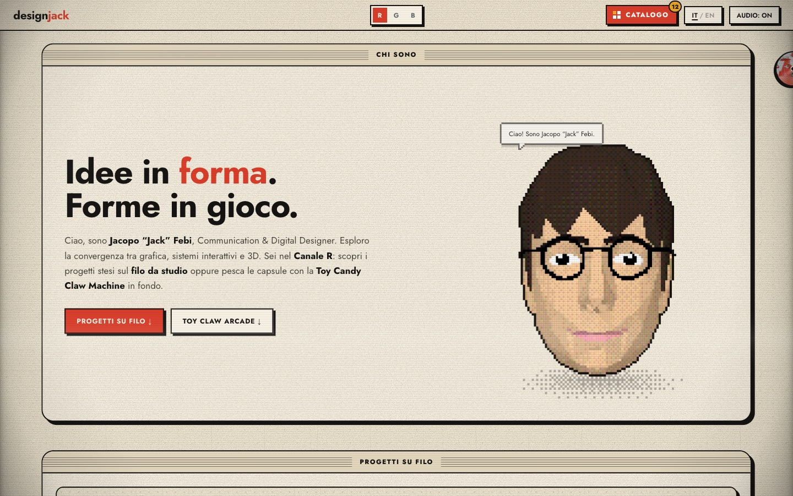
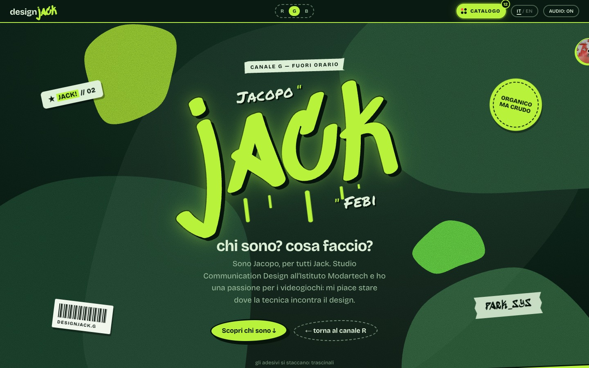
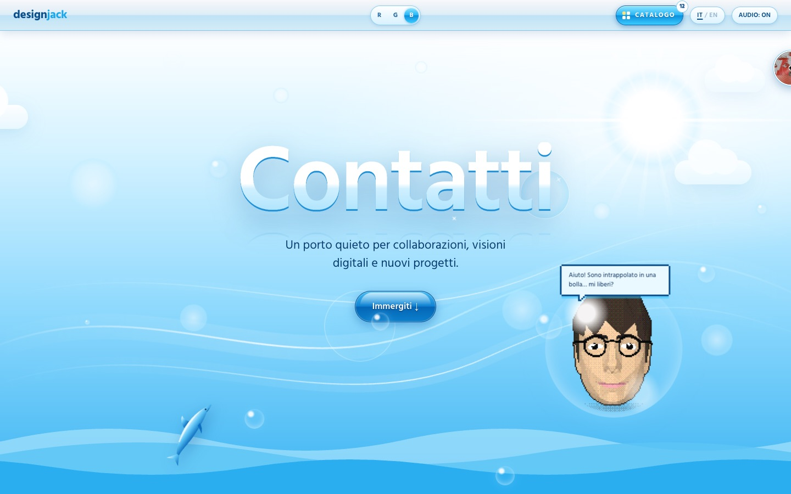
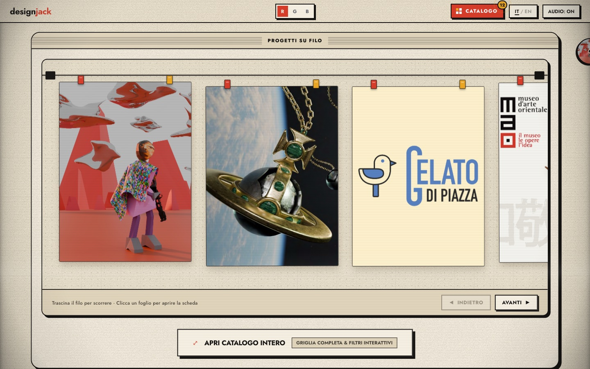
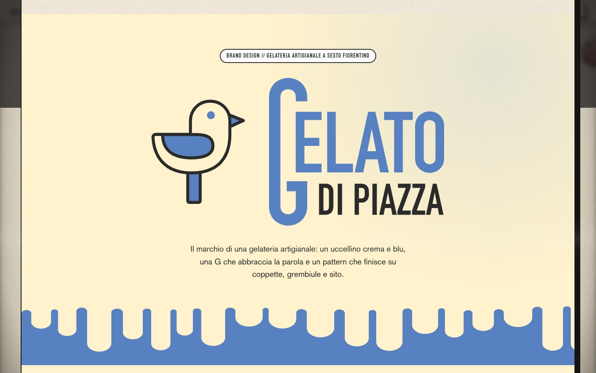
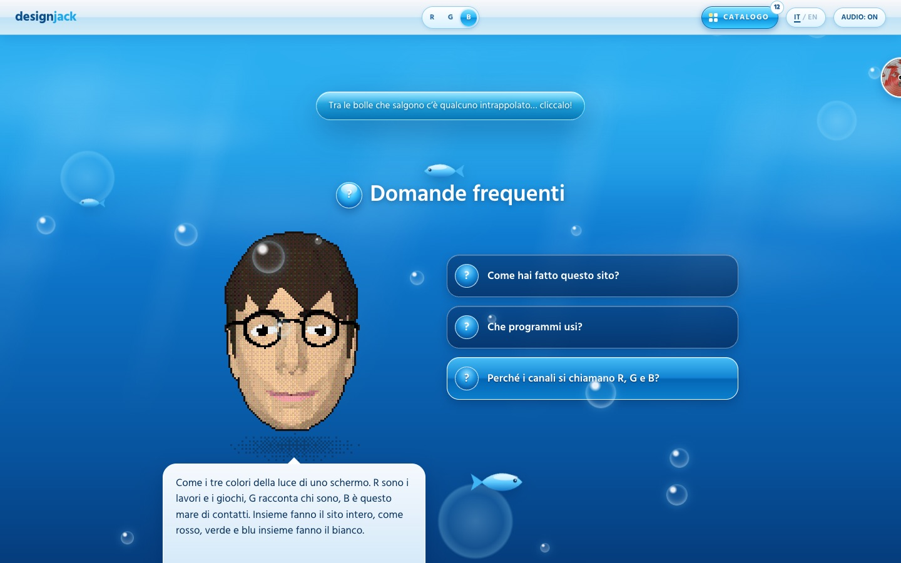
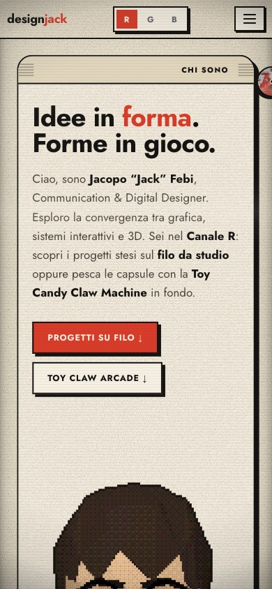

# designjack

**Il portfolio di Jacopo “Jack” Febi, Communication & Digital Designer.**
Un sito che si sintonizza su tre canali, R, G e B, come i tre colori di uno schermo.

> *In English:* the portfolio of Jacopo “Jack” Febi, communication & digital designer. A static, no-build website (HTML, CSS, vanilla JS, Three.js) split into three visual “channels”, R, G and B, each with its own art direction. The whole site can be switched to English from the IT / EN button.

| Canale R | Canale G | Canale B |
|---|---|---|
|  |  |  |
| Lavori e playground | Chi sono | Contatti |

---

## Cosa c'è dentro

- **Tre direzioni artistiche, un solo sito.** Bauhaus su carta con filtro CRT (R), organico × graffiti (G) e Frutiger Aero marino (B). Si passa dall'una all'altra con una transizione da vecchio televisore.
- **12 progetti, ognuno con la sua pagina.** Ogni scheda ha un layout costruito sul progetto: riviste da sfogliare, un mini gioco, un sipario che si apre, un logo che segue il puntatore.
- **Un avatar 3D che parla.** La mia testa modellata in Blender, resa come su un Nintendo DS: segue il cursore, si trascina, commenta quello che guardi e ogni tanto fa qualcosa di buffo.
- **Una claw machine 2D** con fisica vera: ogni capsula pescata apre un progetto.
- **Italiano e inglese**, con la scelta ricordata nel browser.
- **Pensato anche per il telefono**: menu ☰, gesti col dito, layout dedicati.

| Progetti sul filo | Una scheda progetto |
|---|---|
|  |  |

| Domande frequenti, con l'avatar che risponde | Su telefono |
|---|---|
|  |  |

---

## I tre canali

| | Stile | Sezioni |
|---|---|---|
| **R — Realizzazioni & Ricreazione** | Bauhaus su carta, monitor CRT. Font Jost. | Presentazione con l'avatar e un pennello retinato che scopre una composizione nascosta · **Progetti su filo**: fogli appesi che oscillano, da trascinare · **Catalogo** con filtri · **Toy Claw Machine** |
| **G — Germogli & Graffiti** | Muro notturno, spray, adesivi. Font Bricolage Grotesque, Sedgwick Ave Display, Fraunces. | Tag “jack” con le colature · Chi sono, con una carta d'identità ad adesivi · Il percorso di studi come livelli di un gioco · La cassetta degli attrezzi · Cosa faccio · Fuori orario (videogiochi e 3D) · Come lavoro |
| **B — Bolle & Bottiglie** | Frutiger Aero, vetro lucido e mare. Font Hind. | Superficie con sole e delfino · Discesa sott'acqua · Contatti (email da copiare, Instagram, LinkedIn) · Messaggio in bottiglia · Domande frequenti con l'avatar |

In tutti i canali ci sono il pulsante **CATALOGO**, lo switch **IT / EN**, il **music player** (un disco incastrato nel bordo che suona due brani di Ikigai) e un easter egg col Konami code.

---

## Progetti

| Progetto | Categoria | Anno | Nella pagina |
|---|---|---|---|
| designjack — il portfolio | Web Design | 2026 | Il sito raccontato da sé: Design × Cultura visiva × AI, moodboard, i tre canali, come è stato costruito |
| Ikigai × designjack — Yūgen / Kōkotsu | Collaborations | 2025 | Copertina che segue il puntatore, Canvas per Spotify che comanda il player del sito |
| Hieronymus Bosch × Vivienne Westwood | Graphic Design | 2025 | Il ciondolo in 3D, il processo in Blender, l'Armor Ring accanto al trittico |
| Gelato di Piazza | Brand Design | 2025 | Logo vettoriale con l'uccellino che ti guarda, percorso del marchio, palette a palline di gelato, sito con slider |
| MAO — Museo d'Arte Orientale | Editorial Design | 2026 | Kanji a pennellate, la gabbia di Van de Graaf disegnata dal vivo, catalogo da sfogliare, campagna |
| Decoder | Editorial Design | 2026 | Fanzine punk: segnale da sintonizzare, micropunti gialli da scoprire con la luce blu, rivista da sfogliare |
| Modartech — Fotografia | Editorial Design | 2026 | Magazine da sfogliare, schemi di luce interattivi, confronto foto originale / AI |
| Melagoccio | Brand Design | 2025 | Felpa che si gira, figurine a ventaglio, banner Instagram |
| Teatro Salone Ablondi | Brand Design | 2025 | Sipario che si apre sul marchio, costruzione del simbolo |
| Campari Champ-AR | Interaction Design | 2026 | Packaging arcade e un mini gioco endless giocabile ([codice del gioco AR](https://github.com/jackdesigz/champar)) |
| La Fanciulla del West | Graphic Design | 2025 | Carta che si gira, bozze su un tavolo verde, mockup |
| Echo Sound Festival | Graphic Design | 2025 | Anelli psichedelici, illustrazioni come adesivi |

---

## Tecnologie

- **HTML, CSS e JavaScript senza framework e senza build.** Si apre con un server statico qualsiasi.
- **[Three.js](https://threejs.org/) r128** (da CDN) per l'avatar e la capsula 3D, con `GLTFLoader` in `js/vendor/`.
- **Canvas 2D** per la claw machine, il gioco di Campari, il dithering e le animazioni dei progetti.
- **Web Audio** per i suoni dell'interfaccia.
- **Traduzione senza librerie**: un dizionario italiano → inglese applicato al DOM, anche al contenuto creato dopo (`js/i18n.js`).
- Font da Google Fonts e font locali in `assets/fonts/`.

---

## Avvio in locale

```bash
git clone https://github.com/jackdesigz/portfolio_designjack.git
cd portfolio_designjack
python3 -m http.server 8080
```

Poi apri <http://localhost:8080>.

Va aperto da un server, non come file (`file://`): altrimenti il browser blocca il modello 3D, le maschere degli spruzzi e alcuni font.

---

## Struttura

```
index.html                 pagina unica: tre canali, catalogo, schede progetto
css/
  styles.css               base e canale R
  channel-g.css            canale G
  channel-b.css            canale B
  catalog-ui.css           catalogo, switch R/G/B, pulsante CATALOGO
  project-page.css         intestazione delle schede (nello stile del canale)
  project-*.css            layout dedicati dei progetti
  mobile.css · music-player.css · easter-egg.css
js/
  main.js                  cambio canale, catalogo, filtri
  channels.js              animazioni di G e B, domande frequenti
  projects.js              registro dei progetti
  modal.js                 scheda progetto
  project*.js              layout dedicati (Editorial, Brand, Gelato, Champar, Ikigai, Bosch, designjack)
  hangingCatalog.js        progetti sul filo
  crane2d.js · clawPhysics2D.js   claw machine
  heroAvatar.js · avatarPilot.js  avatar 3D e i suoi spostamenti
  i18n.js · i18n-en.js     italiano / inglese
  navMenu.js               menu ☰ su telefono
  dither.js · musicPlayer.js · audio.js · konami.js · softwareIcons.js
assets/                    immagini dei progetti, font, avatar, suoni
docs/screenshots/          immagini di questo README
Musica/                    brani del player
Progetti/                  materiali originali (PDF, sorgenti)
Avatar/                    export da Blender dell'avatar
tools/glbprune.py          alleggerisce il modello dell'avatar
archive/                   versioni precedenti (claw machine 3D, avatar 2D)
```

---

## Come si estende

### Aggiungere un progetto

1. Crea `assets/projects/<progetto>/` con `cover.jpg` (catalogo e filo) e, se deve finire nella claw machine, `capsule.png` (quadrata, 256 px).
2. Aggiungi la voce in `js/projects.js`: `id`, `title`, `category`, `year`, `coverImage`, `capsuleImage`, `software`, `palette`, `style`, testi di panoramica e progettazione e `gallery`.
3. Per la pagina scegli tra:
   - le sezioni standard di `gallery`: `poster`, `moodboard`, `sketches`, `illustrations`, `mockups`, `download`;
   - un layout dedicato: registra `window.PROJECT_LAYOUTS.<nome>` (una funzione che disegna la pagina e restituisce la sua funzione di pulizia) e metti `gallery.layout: '<nome>'`.
4. Una categoria nuova va aggiunta anche tra i filtri del catalogo e in “Cosa faccio” del canale G (`data-cat` in `index.html`).

### Tradurre un testo

Il sito è scritto in italiano. Per tradurre un testo nuovo aggiungi una riga a `js/i18n-en.js`: la chiave è il testo italiano esatto, il valore è l'inglese. Le frasi con una parte variabile vanno in `I18N_EN_RULES`. I testi disegnati su canvas passano da `window.i18n.t()`.

### Aggiornare l'avatar

Esporta da Blender in `Avatar/Avatar.glb`, poi:

```bash
python3 tools/glbprune.py Avatar/Avatar.glb assets/avatar/jacopo-head.glb alta
```

Il comando toglie la scansione fotografica “alta” (1,4 MB → 170 KB). Le parti si riconoscono dal nome che hanno in Blender: `testa`, `occhi`, `sopracciglia`, `capelli`, `Occhiali`. Sorriso, carnagione e intensità del retino si regolano con `SMILE`, `SKIN_TONE` e `DITHER` in cima a `js/heroAvatar.js`.

---

<details>
<summary><strong>Note tecniche</strong></summary>

- **Cache.** CSS e JS sono richiamati con `?v=` in `index.html`: quando modifichi un file, alza il suo numero.
- **Animazioni per tutti.** Per scelta il sito ignora l'impostazione di sistema “riduci movimento” (in Windows, “mostra animazioni” spento), così anche chi ce l'ha attiva vede il sito animato. Gli script chiedono a `window.djReduceMotion()`, definita nel `<head>` di `index.html`, che oggi restituisce sempre `false`. I blocchi CSS `prefers-reduced-motion: reduce` sono spenti con `and (update: none)`. Per tornare a rispettare l'impostazione: fai restituire a `djReduceMotion` il valore di `matchMedia('(prefers-reduced-motion: reduce)').matches` e togli `and (update: none)` dal CSS.
- **Trackpad.** Il filo dei progetti ferma i gesti orizzontali (listener `wheel` non passivo), altrimenti Chrome, Edge e Safari li prendono per “indietro / avanti” nella cronologia.
- **Prestazioni.** Lo scroll gira a 60 fps in tutti i canali:
  - l'avatar non usa l'antialias WebGL;
  - la barra in alto non usa `backdrop-filter`;
  - il catalogo ha un fondo pieno e nasconde il sito sotto.
- **Telefono.** Sotto i 760 px catalogo, lingua e audio passano nel menu ☰ (`js/navMenu.js`). L'avatar si gira col gesto orizzontale, mentre quello verticale scorre la pagina.
- **Percorsi.** `assets/Immagini` ha la I maiuscola: online le maiuscole contano.
- **Claw machine 3D.** `js/crane.js` è la vecchia versione 3D e la pagina non la carica. Come riattivarla è spiegato in `archive/claw-machine-3d/LEGGIMI.md`.
- **File troppo grandi.** Il PDF di Modartech (117 MB) supera il limite di GitHub ed è in `.gitignore`. Il sito non lo usa: le pagine sono già in `assets/projects/modartech/pages/`.

</details>

<details>
<summary><strong>Font</strong></summary>

- **Font locali** in `assets/fonts/`: Upheaval TT, Radlush, BLOCKY, Decondol, Super Earthly, Rotis Semi Serif, Boldark, Monobloco, Akzidenz Grotesk CE Roman. Monobloco è libero anche per uso commerciale. Per gli altri bisogna verificare la licenza prima di riusarli: Rotis (Adobe) e Akzidenz Grotesk (Berthold) sono a pagamento.
- **Font sostituiti sul sito**, perché non si possono distribuire:
  - Druk Trial → Anton (Decoder);
  - Canela → Cormorant Garamond (Modartech);
  - Gill Sans → Hind fuori dai dispositivi Apple (MAO);
  - DIN Condensed Bold → Barlow Condensed fuori da macOS e iOS (Gelato di Piazza).
- Il file di Akzidenz Grotesk CE ha la legatura “fi” difettosa: nel layout di Gelato di Piazza le legature sono spente.

</details>

---

## Contatti

- Instagram: [@jacopo.febi](https://www.instagram.com/jacopo.febi/)
- LinkedIn: [jacopofebidesigner](https://www.linkedin.com/in/jacopofebidesigner/)
- Email: jacopofebi27@gmail.com

## Diritti

Il repository non ha una licenza open source. Progetti, immagini, testi e modello 3D sono lavori di Jacopo Febi: per riutilizzarli serve il suo permesso. I font di terze parti restano soggetti alle loro licenze.
